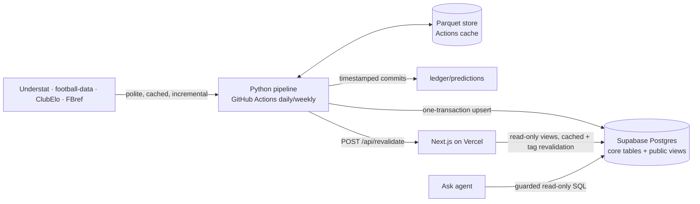

# PitchIQ

**Football analytics for Europe's top 5 leagues** (Premier League, La Liga, Bundesliga, Serie A, Ligue 1): match predictions with a public track record, an in-house xG model, expected-points tables, player similarity search, and a plain-English "Ask" agent that writes and shows its SQL. Updates daily; runs on free tiers.

> Built as an end-to-end portfolio project covering ML (xG, Dixon–Coles, LightGBM, similarity), data engineering (incremental scraping, canonical IDs, validation, Parquet/DuckDB, Postgres) and a production web app (Next.js, Vercel).

## Architecture



Full design, schema and size estimate: [`docs/phase-0-plan.md`](docs/phase-0-plan.md). Operations: [`docs/runbook.md`](docs/runbook.md).

## What's inside

| Area | Highlights |
|---|---|
| **Data engineering** | Rate-limited HTTP client with cache and retries; Understat JSON endpoints (keeps `lastAction` + penalties); canonical team IDs by optimal assignment over fuzzy scores, **verified by exact fixture-list agreement across sources**; pandera schemas, cross-source score checks; keep-last-good + failing runs email the owner |
| **xG model** | LightGBM vs logistic baseline vs Understat xG on whole held-out seasons; distance/angle in metres, game state, body part, last action; calibration + SHAP; penalties at empirical rate |
| **Match predictor** | Dixon–Coles per league (time decay, analytic gradient, promoted-team priors) + LightGBM on pre-match features; ensemble weight chosen on past seasons only; **walk-forward backtest vs Shin-adjusted closing odds**; live predictions in an append-only git ledger + a DB trigger that rejects post-kickoff predictions |
| **xPts** | 10,000-simulation shot-level Monte Carlo, verified against the exact Poisson-binomial |
| **Similarity** | Per-90 profiles within season × position group, PCA + cosine kNN (pgvector for live Scout filters), percentile radars; FBref linking with reported match rate |
| **Ask agent** | Structured-output text-to-SQL, AST-parsed single-SELECT guard, view whitelist, read-only DB role, 5 s timeout, 200-row cap, daily quota, 30-question eval set |
| **Web** | Next.js 16 Cache Components, dark mode, validated colour palette, responsive; Lighthouse (local build): Performance 92–99, Accessibility 95–96, Best practices 96, SEO 91–100 |

## Results

Model reports are generated by the weekly workflow from real data and committed here:
- xG: [`pipeline/reports/xg_report.md`](pipeline/reports/xg_report.md)
- Match predictor backtest: [`pipeline/reports/predictor_report.md`](pipeline/reports/predictor_report.md)
- Ask agent accuracy: `web/eval/report.md` (manual workflow)

> **Status (3 Nov 2026):** all code, tests, database and workflows are in place. Real-data runs are pending because Understat blocks cloud IP ranges; see the runbook for the self-hosted runner setup. Report tables will appear here after the first backfill. No numbers are shown until they come from real data.

## Run it locally

```bash
# pipeline
cd pipeline && uv sync && uv run pytest
uv run pitchiq ingest --max-match-requests 500   # incremental, cached, polite
uv run pitchiq validate && uv run pitchiq train-xg && uv run pitchiq backtest
uv run pitchiq models && SUPABASE_DB_URL=... uv run pitchiq publish

# web
cd web && cp .env.example .env.local && npm install && npm run dev
```

## Tests

- Pipeline: 46 pytest tests: a synthetic multi-source "fake world" end to end, HTTP politeness, Dixon–Coles gradient check, xPts vs exact maths, backtest on simulated leagues, and Postgres integration tests (migrations, publish idempotency, `anon` cannot write or read secrets, Ask guardrails, kickoff trigger).
- Web: 21 vitest tests (data helpers, SQL guard incl. injection attempts, eval-set leakage check).
- CI runs both on every push (Postgres with pgvector as a service).

## Limitations

Free event data has no freeze frames, so xG can't see defender positions. Defensive actions aren't available, so defensive profiles are weak. Rest days only count league matches. The live track record starts at launch. Edges are disagreements with the market, not betting advice.

## Data sources & credits

[Understat](https://understat.com) · [football-data.co.uk](https://www.football-data.co.uk) · [ClubElo](http://clubelo.com) · [FBref](https://fbref.com) · approach informed by [soccerdata](https://github.com/probberechts/soccerdata). All data belongs to its providers; PitchIQ publishes derived analytics only.
