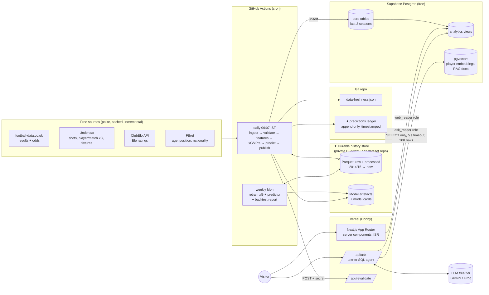

# Phase 0: Plan

Status: **draft, waiting for approval**. Nothing past scaffolding gets built until this is signed off.

---

## 0. Name

"PitchIQ" works: it's short, says what the product is and is easy to remember. Two cautions: several unrelated apps already use "PitchIQ" (worth a quick domain/SEO check), and the GitHub repo is currently called `top5-football-analytics`, not `pitchiq`.

Alternatives, if you want something more distinctive:

| Name | Why |
|---|---|
| **xFive** | xG + "Big 5" leagues. Short, signals analytics straight away. |
| **Underlying** | Analysts' phrase for the numbers beneath the result ("the underlying numbers"). |
| **Big5 Lab** | Says the scope and the experimental/ML angle. |
| **Expected Edge** | Combines expected goals/points with edge vs bookmakers. |

My recommendation: keep **PitchIQ** as the brand unless the domain check fails, then use **xFive**. The repo name doesn't need to change; the Python package is `pitchiq` either way.

---

## 1. Architecture

I recommend your default stack, with three changes (marked ★).



### The three changes

**★ 1. A durable store for the Parquet history.** GitHub Actions runners are ephemeral: anything on disk is gone when the job ends. "Never re-download what we already have" therefore needs persistent storage outside the runner. Options:

| Option | Cost | Private? | Notes |
|---|---|---|---|
| **Hugging Face private dataset repo** (recommended) | Free | Yes | Versioned like git, large-file friendly, `huggingface_hub` Python API, can also hold model artefacts + model cards. You already have an HF account. |
| GitHub Release assets | Free | **No** (public repo → public assets) | Redistributing scraped Understat data publicly is a terms risk. |
| Supabase Storage | Free (1 GB) | Yes | Fine fallback; ties two concerns to one vendor. |
| Actions cache | Free | Yes | Evicted after 7 days without access and not guaranteed. Too fragile to be the source of truth. |

The daily job downloads the processed Parquet (~30–60 MB) plus the HTTP cache, does incremental work, and uploads only the changed partitions.

**★ 2. A predictions ledger committed to git.** Every pre-kickoff prediction is appended to `ledger/predictions/YYYY-MM.csv` and committed by the daily job. This does two jobs at once:
- It is **tamper-evident proof** of the live track record: git timestamps show each prediction existed before kickoff. Recruiters can verify it.
- It is the commit that stops GitHub pausing scheduled workflows after 60 days. `data-freshness.json` is committed alongside it.

**★ 3. The Ask agent queries curated `analytics.*` views, not raw tables.** These are wide, well-named, documented views (e.g. `analytics.player_season`, `analytics.team_match`) with per-90 columns already computed. This improves text-to-SQL accuracy a lot, and the read-only role can only see these views.

### Should we use a simpler stack (one Python app)?

I looked at Streamlit or Dash on a free host as a single Python app.

| | Next.js + Supabase (your default) | Single Python app (Streamlit) |
|---|---|---|
| Polish / speed | Static + ISR pages, sub-second loads, Lighthouse 90+ | Slow cold starts on free hosts (HF Spaces/Render sleep), limited layout control |
| Signals to recruiters | Full-stack + data engineering + ML | ML/DS only; reads as a notebook demo |
| Free-tier fit | Vercel Hobby + Supabase free both fit comfortably | HF Spaces works, but sleeps |
| Effort | Higher (two languages) | Lower |

**Verdict: keep your default.** The extra effort is the point of a flagship project: it shows the full system. The one simplification I'd make is no separate API server. Next.js server components read Postgres directly, and the pipeline writes directly. Python never serves web traffic.

### Key runtime decisions

- **Primary source for results and fixtures is Understat**, not football-data. Understat updates within hours of full time and carries the full season schedule. football-data (updated about twice a week) is used for **odds** and as a **cross-check** on scores. A validation step fails the run if the two sources disagree on a finished match's score.
- **Odds:** use closing odds for backtesting and evaluation (Pinnacle closing `PSC*` where present, otherwise market average `AvgC*`). For upcoming "edges vs bookmakers", use the pre-match odds in `fixtures.csv`. These may be missing for midweek fixtures because of the update schedule; the UI will say so rather than hide it. The overround is removed with **Shin's method**, with basic normalisation as a fallback (both reported).
- **Web reads Postgres directly** through Supabase's connection pooler (`postgres.js`), as a `web_reader` role with `SELECT` on `analytics.*` only. No anon key is exposed to the browser and no RLS is needed for reads.
- **Revalidation:** pages use ISR with `revalidateTag('pitchiq-data')`. The daily job calls `POST /api/revalidate` with a shared secret.
- **Cron:** `37 0 * * *` UTC = **06:07 IST**. GitHub delays jobs scheduled on the hour, so the minute is offset. Weekly retrain runs Monday `17 1 * * 1` UTC.
- **Python env:** `uv` with a lockfile. Python 3.11 pinned in CI.

---

## 2. Folder structure

```
.
├── pipeline/                     # Python 3.11 package "pitchiq"
│   ├── pyproject.toml            # deps, ruff, pytest config
│   ├── config/
│   │   ├── leagues.yaml          # league ids + per-source names, n_teams
│   │   ├── settings.yaml         # every tunable number (decay, sims, thresholds, rate limits)
│   │   ├── team_aliases.yaml     # manual team-name overrides across sources
│   │   └── player_overrides.csv  # manual Understat↔FBref player matches
│   ├── src/pitchiq/
│   │   ├── config.py             # pydantic-validated config loader
│   │   ├── cli.py                # `pitchiq ingest|validate|train|predict|publish|daily`
│   │   ├── ingest/               # football_data.py, understat.py, clubelo.py, fbref.py
│   │   ├── canonical/            # teams.py, players.py (IDs, fuzzy matching)
│   │   ├── validate/             # pandera schemas + cross-source checks
│   │   ├── storage/              # parquet layout, duckdb views, HF remote sync
│   │   ├── features/             # rolling xG, rest days, form, Elo joins
│   │   ├── models/
│   │   │   ├── xg/               # geometry, logistic baseline, LightGBM, penalties
│   │   │   ├── predictor/        # dixon_coles.py, gbm.py, ensemble.py
│   │   │   ├── xpts.py           # shot-level Monte Carlo
│   │   │   └── similarity.py     # per-90 vectors, PCA, kNN, percentiles
│   │   ├── evaluation/           # metrics (log loss, Brier, RPS), backtest, calibration, reports
│   │   └── publish/              # supabase upsert, ledger, freshness, revalidate
│   ├── tests/
│   └── reports/                  # generated evaluation reports (markdown + PNG)
├── web/                          # Next.js app (created in Phase 6)
├── supabase/
│   └── migrations/               # SQL migrations (Phase 5)
├── ledger/predictions/           # append-only prediction ledger (committed daily)
├── docs/                         # this plan, methodology, data sources, ADRs
├── .github/workflows/            # ci.yml (now), daily.yml + weekly.yml (Phase 8)
├── data-freshness.json           # committed daily (Phase 8)
└── .env.example
```

Local data lives in `pipeline/data/` (git-ignored):
`raw/<source>/…` (HTTP cache) → `processed/<table>/league=…/season=…/part.parquet` → `pitchiq.duckdb` (views over Parquet).

---

## 3. Canonical IDs

| Entity | Canonical ID | How |
|---|---|---|
| League | `ENG1`, `ESP1`, `GER1`, `ITA1`, `FRA1` | Config; maps to each source's code (`E0`, `EPL`, `ENG-Premier League`, …) |
| Season | `2627` (start year + end year, two digits each) | Matches football-data's URL scheme; label `2026/27` |
| Team | slug, e.g. `eng-arsenal`, `ger-bayern-munich` | soccerdata's uniform names → slug. `team_aliases.yaml` for leftovers. **A test asserts that every team name in every source maps.** |
| Player | `p<understat_id>` (e.g. `p8260`) | Understat is the richest player source, so its ID is the spine. FBref players are attached by rapidfuzz on (normalised name, canonical team, season), with an accept threshold from config plus `player_overrides.csv`. The match rate is reported every run. |
| Match | Understat match ID | football-data rows are joined on (league, date ±1 day, home, away). Unmatched rows fail validation. |
| Shot | Understat shot ID | |

---

## 4. Database schema (Supabase)

Full DDL lands in Phase 5 as migrations. Draft:

### `public`: core tables (pipeline writes, web never reads directly)

```sql
leagues        (league_id text PK, name, country, n_teams int)
seasons        (season_id text PK, label, start_date, end_date, is_current bool)
teams          (team_id text PK, name, short_name, league_id FK, crest_url null)
players        (player_id text PK, name, understat_id int UNIQUE, fbref_id text UNIQUE NULL,
                birth_year int NULL, nationality text NULL, position_group text CHECK in (FW,AMW,CM,DEF,GK))

matches        (match_id bigint PK, league_id, season_id, kickoff_utc timestamptz,
                home_team_id FK, away_team_id FK, status text CHECK in (scheduled,finished,postponed),
                home_goals smallint, away_goals smallint,
                home_xg real, away_xg real,               -- our xG
                home_xg_understat real, away_xg_understat real,
                updated_at timestamptz)
odds           (match_id FK, source text, captured_kind text CHECK in (pre,closing),
                odds_h, odds_d, odds_a real, p_h, p_d, p_a real, overround real,  -- p_* margin-removed
                PK (match_id, source, captured_kind))
shots          (shot_id bigint PK, match_id FK, team_id FK, player_id FK, minute smallint,
                x_m real, y_m real, distance_m real, angle_rad real,
                situation text, shot_type text, last_action text, result text, is_goal bool,
                xg real, xg_understat real, game_state smallint)
player_match   (match_id, player_id, team_id, minutes, goals, assists, shots, key_passes,
                xg, xa, npxg, xg_chain, xg_buildup, PK (match_id, player_id))
player_season  (player_id, season_id, team_id, league_id, minutes, goals, assists, shots,
                key_passes, xg, xa, npxg, xg_chain, xg_buildup, age int, position_group,
                PK (player_id, season_id, team_id))
elo_ratings    (team_id, valid_from date, valid_to date, elo real, PK (team_id, valid_from))
                -- ClubElo's own interval format: ~40 rows/team/season instead of 365
```

### Model outputs

```sql
model_runs       (model_version text PK, model_kind text, trained_at, train_seasons text[],
                  params jsonb, metrics jsonb)
predictions      (prediction_id bigserial PK, match_id FK, model_version FK,
                  model_name text CHECK in (dixon_coles, gbm, ensemble),
                  created_at timestamptz, p_home, p_draw, p_away real,
                  exp_home_goals, exp_away_goals real, top_score text,
                  score_grid jsonb,                -- 0..8 x 0..8 probabilities, frozen row only
                  is_frozen bool)                   -- the last pre-kickoff prediction
                  -- trigger: reject INSERT/UPDATE when created_at >= kickoff_utc
xpts_match       (match_id, team_id, p_win, p_draw, p_loss, xpts, n_sims, model_version,
                  PK (match_id, team_id))
season_table     (league_id, season_id, team_id, played, w, d, l, gf, ga, pts,
                  xg_for, xg_against, xpts, pts_minus_xpts, PK (league_id, season_id, team_id))
calibration_bins (model_version, target text, bin smallint, mean_pred real, obs_freq real, n int)
backtest_summary (model_name, league_id, season_id, n, log_loss, brier, rps)   -- incl. 'bookmaker'
```

### Player similarity

```sql
player_percentiles (player_id, season_id, position_group, metric text, per90 real, percentile real,
                    PK (player_id, season_id, metric))
player_embeddings  (player_id, season_id, position_group, league_id, age, minutes,
                    embedding vector(12),          -- standardised (+PCA) per-90 vector
                    PK (player_id, season_id))
                    -- Scout runs live filtered kNN: ORDER BY embedding <=> $1 with WHERE filters
player_similar     (player_id, season_id, rank smallint, other_player_id, other_season_id, similarity)
                    -- precomputed top-10 for player pages
```

### `ops` and Ask

```sql
ops.pipeline_runs  (run_id, started_at, finished_at, status, git_sha, steps jsonb)
ops.data_freshness (source, league_id, last_success_at, latest_match_utc, rows_added, status, message)
ask.docs           (doc_id, title, content, embedding vector(768))   -- schema + football glossary
ask.usage          (day date PK, n_requests int)                      -- daily cap, via SECURITY DEFINER fn
ask.log            (id, asked_at, question, sql, ok, rows, latency_ms, error)  -- pruned after 30 days
```

### `analytics`: read-only views for the web and Ask

`analytics.fixtures`, `analytics.team_match`, `analytics.league_table`, `analytics.player_season`, `analytics.shot`, `analytics.prediction_track_record`, `analytics.freshness`. Each column has a `COMMENT ON COLUMN`, which feeds the RAG context directly.

### Roles

| Role | Rights |
|---|---|
| `pipeline_writer` | DML on `public`, `ops`, `ask.docs` (used by GitHub Actions only) |
| `web_reader` | `SELECT` on `analytics.*` |
| `ask_reader` | `SELECT` on `analytics.*`, `default_transaction_read_only = on`, `statement_timeout = 5s`, `work_mem` capped. The app also enforces a single `SELECT` via an AST parser and wraps every query in `LIMIT 200`. |

---

## 5. Storage size estimate

Matches per season: 3 × 380 (Premier League, La Liga, Serie A at 20 teams) + 2 × 306 (Bundesliga and Ligue 1 at 18 teams) = **1,752 matches/season**.

**Supabase (current season + 2 previous = ~5,300 matches):**

| Table | Rows | Avg row + index | Size |
|---|---|---|---|
| shots | ~135k (≈25/match) | ~200 B | ~27 MB |
| player_match | ~150k (≈28/match) | ~150 B | ~23 MB |
| matches + odds | ~5.3k + ~16k | ~150 B | ~3 MB |
| elo_ratings (interval format) | ~12k | ~80 B | ~1 MB |
| predictions (≈7 daily snapshots/match, grid only on frozen) | ~37k | ~150 B + 5.3k × ~1.2 kB grids | ~12 MB |
| player_season / percentiles / embeddings / similar | ~8k / ~120k / ~8k / ~80k | — | ~20 MB |
| xpts, season_table, calibration, backtest | small | — | ~3 MB |
| ask.docs (≈200 chunks × 768-d) + log | — | — | ~2 MB |
| Postgres overhead, TOAST, pgvector indexes | — | — | ~20 MB |
| **Total** | | | **≈ 110–130 MB** (~25% of the 500 MB limit) |

Growth: each new season adds ~45 MB, and the oldest season is pruned at rollover, so the total stays flat. The pipeline checks `pg_database_size()` and **fails the run above 350 MB** (threshold in config).

**Parquet history (HF private dataset):** about 21k matches and ~530k shots since 2014/15, so **~40–60 MB** compressed plus ~200 MB of HTTP cache. Well within free limits.

---

## 6. Modelling notes (decided now to avoid rework)

- **xG geometry:** Understat `X` runs along the pitch (attacking towards `X = 1`) and `Y` across it. `dx = (1 − X) × 105`, `dy = (Y − 0.5) × 68`. Distance = √(dx² + dy²). Angle = the angle subtended by the posts (7.32 m goal mouth).
- **Penalties:** excluded from the open-play model. They get a constant equal to the empirical conversion rate in the training seasons, computed from data rather than hard-coded.
- **Backtest leakage guard:** the predictor's rolling-xG features in each walk-forward fold come from an xG model trained only on seasons before that fold. Elo is as-of the day before kickoff. Dixon-Coles is refitted per matchweek using only past matches.
- **Promoted teams:** Dixon-Coles has no top-flight history for them. Their priors start from the league's average promoted-team strength, estimated from the data, and the time decay lets them adapt quickly.
- **Backtest seasons:** 2023/24, 2024/25 and 2025/26. The live track record starts on launch day and is shown separately from the backtest, never mixed.
- **Game state:** derived from the goal sequence within each match (Understat shot results plus own goals). If own goals prove unreliable in the data, I'll stop and ask before dropping the feature.

---

## 7. Risks

| # | Risk | Likelihood | Mitigation |
|---|---|---|---|
| 1 | **This cloud session's network policy blocks the data sources** (verified: `understat.com`, `www.football-data.co.uk` and `fbref.com` all return 403). Phase 1 can't be developed or tested against live data here. | Certain, now | You add the hosts to the environment's allowlist (see "Decisions" below). GitHub Actions runners have open internet, so production is unaffected. |
| 2 | **FBref blocks datacenter IPs** (Cloudflare), including GitHub Actions runners. | High | FBref is used only for age, nationality and position: fetched **weekly**, cached, and non-critical. Understat positions are the fallback for grouping. If FBref is unreachable from Actions I'll stop and ask (age-filtered Scout depends on it). |
| 3 | Understat or soccerdata breaks after a site change (it has happened before). | Medium | Pin the soccerdata version. Contract tests on response shape. The keep-last-good-data rule means the site goes stale, not broken. The Action fails so you get an email. |
| 4 | football-data lags results by a few days. | Certain | Understat is primary for results; football-data is used for odds and score cross-checks only. |
| 5 | Supabase free projects pause after 7 days of inactivity. | Low | Daily writes keep it active. |
| 6 | GitHub pauses scheduled workflows after 60 days with no repo activity. | Certain without mitigation | Daily commit of `data-freshness.json` + the prediction ledger. |
| 7 | Team or player name mismatches across sources. | Certain | soccerdata uniform names + alias file + a hard test that every team maps. Player match rate is reported, with an overrides file. |
| 8 | LLM free-tier quotas/ToS change, or abuse of the Ask endpoint. | Medium | Provider set via env (Gemini/Groq/OpenAI). Global daily cap in Postgres plus a per-IP rate limit. Ask degrades gracefully when the cap is hit. |
| 9 | Vercel Hobby function limits on Ask (time, memory). | Low | Streaming responses, 5 s SQL timeout, at most 2 LLM round-trips per question. |
| 10 | Bookmakers beat the model. | Likely, honestly | That is fine: the Model performance page reports it as-is. The edge feature shows *where* the model disagrees, not betting advice. Responsible-gambling disclaimer on the site. |
| 11 | Terms of use: redistributing scraped data. | Medium | Raw data is kept private (HF private repo). The site shows derived analytics with clear attribution. Robots.txt and rate limits are respected. No bulk data download is offered. |
| 12 | Mid-week fixtures missing pre-match odds. | Medium | The edges card shows "odds not yet available" rather than dropping fixtures silently. |

---

## 8. Phase plan (unchanged from brief, with exit criteria)

| Phase | Exit criteria |
|---|---|
| 1 Data pipeline | Backfill of 5 leagues from 2014/15, incremental run is a no-op when nothing changed, all validation checks green, team mapping 100%, tests pass |
| 2 xG + xPts | Evaluation report (log loss, AUC, calibration, SHAP, vs Understat xG), saved model, xPts table for the current season |
| 3 Predictor | Walk-forward backtest report vs closing odds, predictions for the next 7 days |
| 4 Similarity | Embeddings, top-10 similar, percentiles, player match-rate report |
| 5 Supabase | Migrations applied, roles tested (`ask_reader` cannot write or time out the DB), upsert idempotent, size measured |
| 6 Web | Pages 1–7 and 9 deployed, dark mode, mobile, Lighthouse ≥ 90 performance |
| 7 Ask | Guardrail tests, 30-question eval set, accuracy report |
| 8 Automation | Daily + weekly workflows green, failure emails verified, revalidation working |
| 9 Polish | README, GIF, SEO, credits |

---

## 9. Decisions I need from you

1. **Name:** keep PitchIQ, or switch (xFive / Underlying / other)?
2. **History store:** private Hugging Face dataset repo (recommended), Supabase Storage, or something else? The HF route needs a free write token as a GitHub secret later.
3. **Network allowlist for this cloud environment**, so I can build and test Phase 1 against real data. Hosts:
   `understat.com`, `www.football-data.co.uk`, `football-data.co.uk`, `api.clubelo.com`, `clubelo.com`, `fbref.com`, `raw.githubusercontent.com` (StatsBomb, optional), `huggingface.co` (if HF is chosen).
4. **Default LLM for Ask:** Gemini (Flash, free tier) or Groq (Llama-class, free tier)? Both are free; Gemini also provides free embeddings for RAG, so it's my default.
